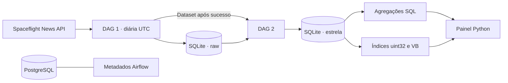
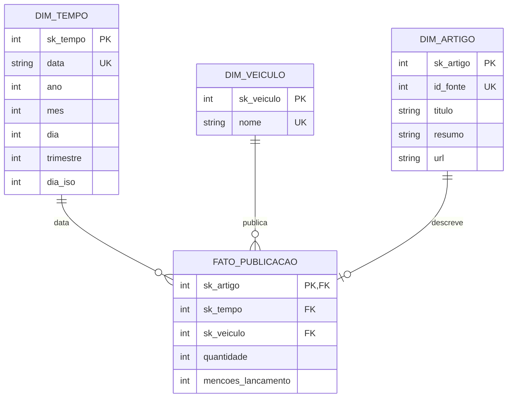

# Observatório de notícias espaciais

**Arthur Lemos e Melissa Almeida** · FUCAPE Business School · Trabalho Prático Integrado 2 · 2026

## Pergunta de negócio

Quais veículos concentram a cobertura do setor espacial e onde um analista pode encontrar matérias sobre um lançamento ou missão? O observatório reúne publicações de diversas redações em um acervo pesquisável e mede o volume editorial por veículo e período. A unidade analisada é a matéria. Dois veículos podem cobrir o mesmo evento.

Na amostra de janeiro de 2025, a API retornou **534 matérias de 11 veículos**. NASA (181) e SpaceNews (168) somaram **65,4%** do acervo. As matérias continham 216 vínculos com lançamentos. A concentração descreve a seleção editorial da fonte e o período analisado. [Documentação da Spaceflight News API](https://api.spaceflightnewsapi.net/v4/docs/)

## Como experimentar agora

O ZIP inclui o banco da amostra em `data/observatorio.db`. Extraia o pacote, abra um terminal na pasta que contém este README e, com Python 3.11 ou superior, execute:

```console
python -m app.painel
```

Abra [o painel](http://127.0.0.1:8501), pesquise `lunar lander` e consulte **Engenharia**. Para encerrar o servidor use Ctrl+C. A aplicação usa a biblioteca padrão. Quem obtiver apenas os arquivos do Git pode recriar a amostra com os comandos de coleta e carga abaixo antes de iniciar o painel.

## Arquitetura e confiabilidade



O PostgreSQL guarda o estado do Airflow. Bronze, estrela e auditoria ocupam tabelas distintas no mesmo arquivo SQLite. Isso permite confirmar a carga da fato e a baixa das pendências na mesma transação. O Compose persiste banco analítico, metadados e logs em volumes e monta o código das DAGs a partir do projeto.

**Ingestão.** A DAG solicita uma janela UTC fechada no início e aberta no fim, com páginas de até 100 registros. Segue a URL `next` da resposta até seu esgotamento, confere a origem e detecta ciclos. Há pausa entre páginas. Erros de conexão, timeout e códigos 408, 429, 500, 502, 503 e 504 ativam até seis tentativas com espera exponencial e jitter. A espera respeita o maior valor entre o cálculo local e `Retry-After`. A tarefa Airflow ainda pode ser repetida duas vezes.

**Idempotência.** Durante a coleta, cada página entra em uma tabela temporária privada. Só após a última página a transação publica o lote na bronze. A chave é o ID da matéria na fonte. O JSON preserva os campos, listas e valores originais. Comparar sua serialização com chaves ordenadas permite marcar como pendentes apenas inclusões e alterações. A reexecução de janeiro confirmou novamente 534 artigos em seis páginas.

**Carga incremental.** A segunda DAG consome o evento de sucesso da primeira. Ela lê as pendências, limpa espaços e entidades HTML, converte o horário para a data UTC e conta os IDs distintos em `launches`. Atualiza dimensões e fato, zera as pendências e registra a auditoria sob a mesma transação. Se uma linha falhar, a carga é revertida. No segundo processamento da amostra houve **zero alterações, 534 fatos e zero violações de chaves estrangeiras**. As dimensões refletem a versão mais recente recebida (tipo 1). Uma correção retroativa pode ser recuperada repetindo a janela correspondente. [Agendamento por datasets no Airflow 2.10.5](https://airflow.apache.org/docs/apache-airflow/2.10.5/authoring-and-scheduling/datasets.html)

## Modelo dimensional

**Grão da fato:** cada linha representa uma matéria identificada pela fonte, na data UTC de sua publicação, associada a um veículo.



| Campo ou dimensão | Significado analítico |
|---|---|
| Tempo | Calendário das datas observadas. Dia ISO vai de 1 (segunda) a 7 (domingo). |
| Veículo | Nome da organização editorial usado para comparar cobertura. |
| Artigo | Identidade de negócio, título, resumo e link para o original. O SQLite atribui as três SKs inteiras independentemente das chaves da fonte. |
| Quantidade | Métrica aditiva, sempre 1. Sua soma mede matérias publicadas. |
| Menções a lançamento | Métrica aditiva, quantidade de lançamentos distintos vinculados **dentro da matéria**. Um lançamento citado em duas matérias contribui duas vezes. |
| Veículos distintos | KPI calculado por contagem distinta de SK. Recalcular ao mudar o período ou agrupamento. |

## Recuperação de informação

Foi escolhida a **opção 1, índice invertido com d-gaps e Variable Byte**. A indexação converte título e resumo para minúsculas com `casefold`, extrai termos alfanuméricos e associa cada termo à lista ordenada das SKs dos artigos que o contêm. A consulta combina os termos por união. Cada termo encontrado contribui uma vez com o peso `1 + ln((1 + N)/(1 + df))`. Termos raros pesam mais. O desempate usa a menor SK.

O baseline grava cada SK em quatro bytes (uint32 little-endian). A alternativa grava a distância para a SK anterior. Por exemplo, as postagens [4, 9, 140] viram [4, 5, 131]. O codificador separa cada distância em blocos de sete bits, menos significativo primeiro, e marca o último byte com o bit alto. Os dois primeiros gaps cabem em um byte cada e o terceiro usa dois. Na leitura, o decodificador recompõe as distâncias e as soma. Os dois índices usam o mesmo ranking, corpus e top 10.

## Experimento

Medição local em Windows com CPython 3.14.4, 534 documentos e 4.645 termos. Para cada consulta, uma execução prévia de cada método aqueceu o índice. Em seguida foram feitas 200 repetições por método com ordem alternada. O cronômetro `perf_counter_ns` abrange tokenização da consulta, leitura das postagens, pontuação e ordenação. Construção do índice, SQL e renderização ficam fora da medição. O painel repete o experimento com 40 rodadas por método. Os tempos são médias e variam com a máquina.

| Consulta | Antes (ms) | VB (ms) | Δ tempo | Speedup |
|---|---:|---:|---:|---:|
| launch | 0,03311 | 0,03677 | −11,04% | 0,90× |
| space station | 0,09648 | 0,10837 | −12,32% | 0,89× |
| lunar lander | 0,01939 | 0,02137 | −10,18% | 0,91× |
| satellite spectrum | 0,02257 | 0,02465 | −9,21% | 0,92× |

Δ = 100 × (antes − depois) / antes. Speedup = antes / depois. As postagens passaram de **83.100 para 24.793 bytes** (0,083100 para 0,024793 MB), uma economia de **70,16%**. Essa medida soma os buffers binários e exclui dicionários, textos e demais objetos do processo. O decodificador VB em Python teve um custo de CPU maior que a leitura de inteiros fixos por `struct`. A vantagem medida foi de armazenamento. Foi verificada a igualdade das listas decodificadas para **todos os 4.645 termos**, além do ranking para as consultas.

## Execução completa com Airflow

1. Use a pasta extraída do ZIP. Para obter uma cópia Git local, rode `git clone ./observatorio observatorio-t2` a partir da pasta que contém o projeto extraído e entre em `observatorio-t2`. Quando o projeto estiver publicado, substitua a origem local pela URL do repositório da dupla.
2. Com Docker Engine e Compose v2 ativos em modo de contêineres Linux, encerre o painel Python local se estiver usando a porta 8501. Execute na pasta do projeto:

   ```console
   docker compose config -q
   docker compose up -d
   docker compose ps -a
   docker compose exec scheduler airflow dags list-import-errors
   ```

3. Aguarde a inicialização. O serviço `init` deve terminar com código 0. Acesse [Airflow](http://localhost:8080) com usuário `admin` e senha `observatorio`. A DAG diária coleta o último intervalo completo. Para carregar janeiro de 2025, abra **noticias_ingestao**, selecione **Trigger DAG w/ config** e informe o JSON abaixo. Também é possível usar o CLI dentro do scheduler.

   ```json
   {"start":"2025-01-01","end":"2025-02-01"}
   ```

   ```sh
   docker compose exec scheduler bash
   airflow dags trigger noticias_ingestao --conf '{"start":"2025-01-01","end":"2025-02-01"}'
   exit
   ```

4. Na grade do Airflow, acompanhe `coletar_paginas` e depois `noticias_consolidacao → carregar_estrela`. Abra os logs. Repita a mesma janela e confira o total estável. O volume Docker começa independente do banco pré-carregado do ZIP. A execução diária pode acrescentar matérias de outras datas.
5. Abra [o painel](http://localhost:8501). Para conferir a estrela diretamente no contêiner, execute:

   ```console
   docker compose exec painel python -m src.verificar
   docker compose exec painel python -m src.search
   ```

6. Encerre a pilha com `docker compose down`. Os volumes nomeados são reutilizados na próxima subida.

**Validação nesta entrega.** A configuração foi aceita por Docker Compose v2.35.1. A máquina de desenvolvimento não tinha Docker Engine nem WSL instalado. A execução dos contêineres e a demonstração das duas DAGs na UI precisam ser verificadas em uma máquina com Docker. Coleta, carga, repetição da janela, consultas SQL, índices e atendimento HTTP do painel foram executados localmente.

### Reproduzir sem contêineres

```console
python -m src.pipeline ingest --start 2025-01-01 --end 2025-02-01
python -m src.pipeline load
python -m src.verificar
python -m src.search
python -m app.painel
```
